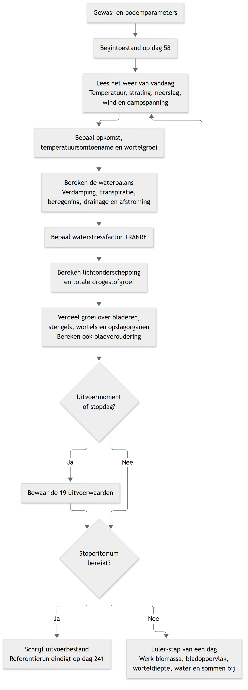

# test_FST_AI
# LINTUL2 voor zomertarwe

Dit pakket is een 1-op-1 Python-port van het meegeleverde FST-model LINTUL2:
lichtonderschepping, drogestofproductie, verdeling over gewasorganen en een
eenvoudige bodemwaterbalans. De oorspronkelijke rekenregels, parameters en
eigenaardigheden zijn behouden; dit is geen verbeterd of opnieuw gekalibreerd model.

## Bestanden

- `LINTUL2.FST`: origineel model met de Fortran-subroutines GLA, PENMAN, EVAPTR en DRUNIR.
- `NLD1.987`: dagelijks weer voor Wageningen (Haarweg), 1987.
- `res.dat`: ongewijzigde referentie-uitvoer van de beregende FST-run.
- `lintul2`: Python-pakket; `tests`: regressie-, unit- en CLI-tests.
- [VERBETERSUGGESTIES.md](VERBETERSUGGESTIES.md): mogelijke verbeteringen, niet uitgevoerd.

De auteursrecht- en licentievermelding van het oorspronkelijke model staan in
`LINTUL2.FST`. Deze port verleent geen aanvullende rechten op dat model.

## Vereiste: Python

Installeer **Python 3.11 of nieuwer**, bijvoorbeeld via
[python.org](https://www.python.org/downloads/). Zorg dat `python` beschikbaar
is in PowerShell en controleer de versie met `python --version`.

Het model gebruikt uitsluitend de standaardbibliotheek. Om het vanuit deze
repository te draaien zijn geen extra pakketten, pakketinstallatie of virtuele
omgeving nodig.

## Uitvoeren

Open PowerShell in de hoofdmap van deze repository en voer uit:

```powershell
python -m lintul2 uitvoer.dat
```

Het standaardweerbestand is `NLD1.987` in de huidige werkmap. Met
`--weather C:\pad\NLD1.987` kies je een ander pad. Het Python-pakket bundelt de
originele databestanden niet; houd ze apart beschikbaar. Een ontbrekend
weerbestand of een ontbrekende gevraagde dag geeft een fout.

De uitvoer heeft dezelfde 19 kolommen, volgorde en tab-scheiding als `res.dat`,
met een header en acht significante cijfers. De FST-commentaarpreambule en
opvulspaties worden niet nagebootst; de uitvoer is numeriek, niet byte-voor-byte
gelijk. Gebruik een nieuw uitvoerpad: de CLI weigert de oorspronkelijke
bronbestanden en het gekozen weerbestand te overschrijven.

### Eenheden van de uitvoer

| Kolom(men) | Betekenis | Eenheid |
|---|---|---|
| TIME | Tijd binnen het jaar | dagnummer |
| LAI | Bladoppervlakte per bodemoppervlakte | m2/m2 |
| WSOTHA | Drogestof in opslagorganen | ton/ha |
| WSO, WST, WLV, WRT | Drogestof in opslagorganen, stengels, bladeren en wortels | g/m2 |
| TSUM | Temperatuursom na opkomst | graaddagen |
| DAVTMP | Gemiddelde dagtemperatuur | graden Celsius |
| DTR | Dagelijkse globale straling | MJ/m2/d |
| ROOTD | Worteldiepte | m |
| TRAN, EVAP | Actuele transpiratie en bodemverdamping | mm/d |
| TRANRF | Actuele gedeeld door potentiele transpiratie, met FST-nulconventie | dimensieloos |
| WA | Watervoorraad in de bewortelde bodem | mm |
| WC | Volumetrisch vochtgehalte | m3/m3 |
| YEAR | Jaar van de weergegevens | kalenderjaar |
| RAIN | Dagelijkse neerslag | mm/d |
| TRAIN | Neerslagsom sinds de start, tot en met de vorige dag | mm |

De subroutines documenteren daarnaast de eenheden van hun argumenten en
retourwaarden. Bij het opbouwen van een uitvoerregel geeft een verschil tussen
het aantal kolomnamen en het aantal waarden een fout, in plaats van gegevens
stilzwijgend weg te laten.

## Testen (optioneel)

Alleen voor de tests is pytest nodig. Een virtuele omgeving is hiervoor
aanbevolen om testafhankelijkheden apart te houden van andere projecten;
deze gebruikt je al geinstalleerde Python. Vanuit de hoofdmap:

```powershell
python -m venv .venv
.\.venv\Scripts\python.exe -m pip install -e ".[test]"
.\.venv\Scripts\python.exe -m pytest -q -s
```

Een virtuele omgeving is optioneel. Als je al een geschikte omgeving gebruikt,
kun je daarin `python -m pip install -e ".[test]"` en
`python -m pytest -q -s` uitvoeren.

## Koppeling met FST

| FST-sectie | Python |
|---|---|
| 1: initialisatie en runbesturing | `parameters.py`, `model.py` |
| 2: weer, opkomst en temperatuursom | `weather.py`, `model.py` |
| 3: bladgroei en veroudering | `model.py`, `subroutines.py:gla` |
| 4: lichtonderschepping en groei | `model.py` |
| 5: verdeling, biomassa en worteldiepte | `model.py` |
| 6: bodemwaterbalans | `model.py`, `subroutines.py:penman/evaptr/drunir` |
| 7: parameters en functietabellen | `parameters.py` |
| FST-hulpfuncties | `fst_functions.py` |
| PRINT en bestandsuitvoer | `model.py:COLUMNS`, `__main__.py` |

Elke vergelijking in `model.py` verwijst naar de FST-sectie. Per dag worden
eerst alle hulpvariabelen en rates berekend uit de huidige toestand en het weer
van die dag. Daarna volgt zo nodig uitvoer, de FINISH-controle en pas dan
Euler-integratie. De integralen in de uitvoer lopen dus tot en met de vorige dag.

## Modelverloop



De [Mermaid-bron van het diagram](docs/lintul2-rekenlus.mmd) is meegeleverd
om de afbeelding later te kunnen bijwerken.

## Validatie en geconstateerde afwijkingen van de prompt

Alle 19 kolommen op alle 38 uitvoertijdstippen worden vergeleken met `res.dat`:
dag 58, 63, ..., 238 en de einddag 241. De tolerantie is relatief `1e-3` en
absoluut `1e-4`; de tijdstippen moeten exact overeenkomen.

Python-float64 voldoet zonder numpy of nabootsing van Fortran-float32.
De aannames over Euler-timing, opkomst, stopcriterium en uitvoertijden
komen binnen de tolerantie overeen met de referentie. Er zijn geen
modelregels aangepast om de vergelijking te laten slagen.

Anders dan de vereenvoudigde bestandsbeschrijving in de prompt bevat
`NLD1.987` ook 24 kwaliteitsregels met stationcode `-999`, naast de 365
meetdagen. Deze regels bevatten vlaggen en worden overgeslagen; de meetregel
met dezelfde dag wordt gebruikt. Er staan geen `-99`-meetwaarden in het bestand.
De lezer weigert zulke ontbrekende waarden, niet-eindige waarden, dubbele
meetdagen en gemengde jaren of stations.

### Grootste relatieve verschil per kolom

Gemeten met Python 3.13, float64, tegen de afgeronde referentie.
Voor een referentienul rapporteert de test het absolute verschil (hier nul).
Met `pytest -q -s` wordt dit overzicht opnieuw berekend.

| Kolom | Maximaal relatief verschil |
|---|---:|
| TIME | 0 |
| LAI | 2.8309038e-5 |
| WSOTHA | 1.8755426e-5 |
| WSO | 1.8755426e-5 |
| WST | 2.7939657e-5 |
| WLV | 2.2989047e-5 |
| WRT | 3.0037984e-5 |
| TSUM | 4.8346548e-5 |
| DAVTMP | 5.5511151e-16 |
| DTR | 0 |
| ROOTD | 7.9626651e-16 |
| TRAN | 4.6374011e-5 |
| EVAP | 3.1099076e-5 |
| TRANRF | 0 |
| WA | 8.581434e-16 |
| WC | 1.5419764e-16 |
| YEAR | 0 |
| RAIN | 0 |
| TRAIN | 4.7747517e-16 |

### Bekende beperkingen

`res.dat` bevat uitsluitend een beregende run (`IRRIGF = 1`).
`TRANRF` is vanaf dag 63 steeds 1; op begindag 58 is de waarde 0 omdat
`PTRAN = 0` en `NOTNUL(0) = 1`. De claim in de prompt dat TRANRF altijd 1 is,
geldt dus niet voor de eerste uitvoerregel.

De droogte- en wateroverlastlogica in EVAPTR en DRUNIR wordt niet door deze
referentie gevalideerd. De unittests voor subroutines bewaken vertaalde
grensgevallen, maar zijn geen onafhankelijke agronomische referentieruns.
Ook andere jaren, gewassen, tijdstappen en configuraties zijn niet gevalideerd.
De FST/EUDRIV-driver is niet opnieuw uitgevoerd; `res.dat` is de onafhankelijke
numerieke referentie. Kleine verschillen kunnen zowel afronding in dat bestand
als de oorspronkelijke REAL-precisie weerspiegelen.